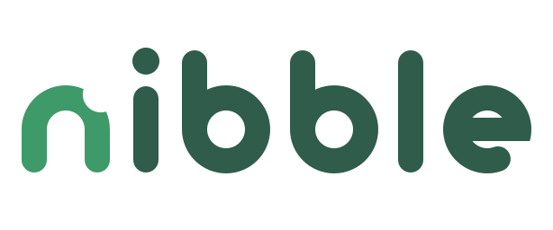

# Nibble: guía de marca

> Una página para el equipo. Si dudás, usá `logo/nibble-logo.svg` sobre crema o blanco.



## 1. El logo

**Idea:** la palabra nibble, con un mordisquito en el hombro de su propia n. Un bocado por vez, sin presión.

**El logo es la palabra.** La n mordida suelta (el símbolo) se usa solo donde la palabra no entra: ícono de la app, favicon y avatar. Nunca va al lado de la palabra.

| Versión | Archivo | Cuándo usarla |
|---|---|---|
| **Logo** | `logo/nibble-logo.svg` | Siempre que entre: encabezado de la app, portada del pitch, web |
| Logo sobre oscuro | `logo/nibble-logo-oscuro.svg` | Diapositivas oscuras: la n en Hoja y el resto en Crema |
| Símbolo | `logo/nibble-simbolo.svg` (y `-oscuro`) | Ícono de la app, avatar, junto al QR |
| Símbolo chico | `logo/nibble-simbolo-chico.svg` | Solo de 16 a 32 px; el mordisco es más grande para que no se pierda |
| Un color | `logo/variantes/*-black.svg`, `*-white.svg`, `*-mono-3e9a68.svg`, `*-mono-2f5c4b.svg` | Impresión a un color, sellos, fondos de foto |

Hay PNG de 1024 px de cada variante en `logo/variantes/`.

## 2. Espacio libre
Alrededor del logo dejá, como mínimo, **la altura de la n** de cada lado. Los SVG ya traen ese aire incluido: no los recortes.

## 3. Tamaño mínimo
| Versión | Pantalla |
|---|---|
| Logo | 80 px de ancho |
| Símbolo | 16 px (con `nibble-simbolo-chico.svg` o el favicon) |

## 4. Color
| Nombre | HEX | RGB | CMYK (aprox.) | Uso | Contraste |
|---|---|---|---|---|---|
| **Verde Nibble** | `#3E9A68` | 62 154 104 | 60 0 32 40 | La n del logo, símbolo, ícono de la app, ilustración y destacados | 3,3:1 sobre crema: sirve para el logo y gráficos, no para texto chico |
| Verde hondo | `#2E7D52` | 46 125 82 | 63 0 34 51 | Botones, links y texto en verde | 4,7:1 sobre crema; texto blanco encima 5,0:1 |
| Verde noche | `#236140` | 35 97 64 | 64 0 34 62 | Hover y presionado | 6,9:1 sobre crema |
| **Pino** | `#2F5C4B` | 47 92 75 | 49 0 18 64 | Resto de la palabra del logo, texto principal y fondos oscuros | 7,1:1 sobre crema |
| Musgo | `#5A6E64` | 90 110 100 | 18 0 9 57 | Texto secundario | 5,1:1 sobre crema |
| Hoja | `#A6DDB9` | 166 221 185 | 25 0 16 13 | La n sobre fondo oscuro, rellenos de gráficos | 5,0:1 sobre Pino |
| Brote | `#EDF7F0` | 237 247 240 | 4 0 3 3 | Tarjetas y superficies | — |
| **Crema** | `#FBF7F0` | 251 247 240 | 0 2 4 2 | Fondo de la app | — |
| Zapallo | `#F0A673` | 240 166 115 | 0 31 52 6 | Acento solo para gráficos e ilustración | No usar para texto sobre claro (1,9:1) |

- **Por qué verde:** se asocia con comer bien y con la salud. Es un verde claro y cálido, no fosforescente. El fondo crema baja el brillo de la pantalla, y la paleta en general es tranquila, coherente con lo sensorial.
- **Por qué dos verdes:** el Verde Nibble es el de la marca, pero no alcanza el contraste para texto chico. Por eso los botones y links usan el Verde hondo.
- **Pares aprobados:** a color sobre blanco o crema · todo blanco sobre Verde Nibble o Pino · versión oscura (Hoja y Crema) sobre Pino o negro · negro sobre blanco.
- **No uses rojo y verde para decir bien o mal** en los gráficos de nutrientes. Sumá siempre texto o un ícono.

## 5. Tipografía
| Rol | Fuente | Pesos | Por qué |
|---|---|---|---|
| Títulos | **Nunito** | 800 y 700 | Puntas redondeadas, como las del logo |
| Texto, botones y números | **Atkinson Hyperlegible Next** | 400 y 700 | Diseñada por el Braille Institute para leer fácil. Distingue 0/O y 1/l/I, clave para los números de nutrientes |

- Las dos son gratis, con licencia SIL Open Font License, y se cargan desde Google Fonts. El `@import` ya está en `tokens/nibble.css`.
- La palabra "nibble" del logo **no es una fuente**: está dibujada a medida. No la escribas con un teclado; usá los SVG.
- Respaldo si Google Fonts no carga: `ui-rounded, 'Segoe UI', system-ui, sans-serif`.

## 6. En la app (React + Vite)
1. **Tokens:** importá `brand/tokens/nibble.css` una vez, en `src/main.tsx`. Usá los roles (`--nb-fondo`, `--nb-texto`, `--nb-primario`…) en lugar de los HEX.
2. **Íconos:** copiá todo `brand/web/` a la carpeta `public/` de la app y pegá `brand/web/head-snippet.html` dentro del `<head>` de `index.html`. El manifest ya trae el nombre y el color.
3. **Logo en la barra:** `import logo from '../brand/logo/nibble-logo.svg'` y ``.
4. **Forma:** bordes redondeados (`--nb-radio: 16px`), mucho aire y sin animaciones bruscas.

## 7. No hacer
No estirar ni deformar · no cambiar los colores fuera de la paleta · no rotar · no agregar sombras, bordes, degradés ni efectos · no mover ni cambiar el tamaño de las partes de un logo · no poner el símbolo al lado de la palabra (la n mordida ya está en la palabra) · no apoyar el logo sobre fotos cargadas sin un fondo liso · no reescribir "nibble" con una fuente.

## 8. Archivos
```
brand/
  BRIEF.md              brief de marca
  GUIA.md               esta guía
  concepts.png          primera ronda (A, B, C); los SVG en concepts/
  logo/                 logo y símbolo en SVG, a color y para fondo oscuro
  logo/variantes/       negro, blanco y un color (SVG y PNG de 1024 px)
  web/                  favicon.ico, favicon.svg, íconos PWA, manifest y snippet del <head>
  tokens/nibble.css     colores, fuentes y forma para la app
  board/                presentación con mockups (HTML y slides/*.png)
  src/                  scripts que generan todo (py -3 brand/src/build_kit.py)
```

## 9. Pendiente o a verificar
- **Marca registrada:** no se hizo búsqueda. Antes de usarlo fuera de la hackathon, revisar la base de la DNPI (Uruguay) y hacer una búsqueda inversa de imágenes.
- **Impresión:** los CMYK son conversiones aproximadas y no hay Pantone definido. Pedir una prueba de color si se imprime.
- **Presentación:** algunos textos de relleno de las maquetas (nombre de la tarjeta, rótulos) los pone la plantilla en inglés.
